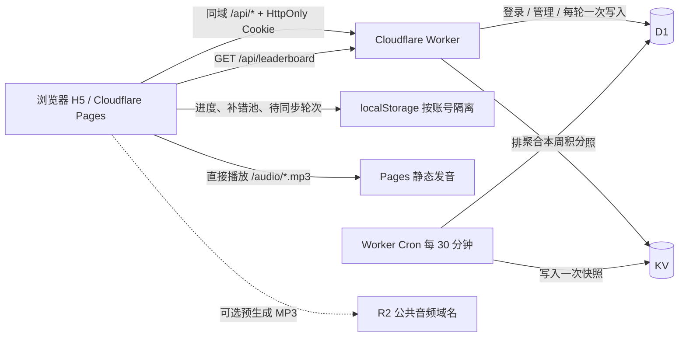

# WordSprout · 单词小芽

面向小学生的英语学习 H5。React + Vite 静态前端，Cloudflare Workers API、D1 数据库与 KV 周榜快照。默认不启用任何付费服务，也不依赖在线 AI/TTS API。

已部署：[wordsprout.hatim.eu.org](https://wordsprout.hatim.eu.org)，[管理员入口](https://wordsprout.hatim.eu.org/admin)。资源与验收记录见 [DEPLOYMENT.md](DEPLOYMENT.md)。

## 整体架构



核心行为：

- 管理员由 seed 创建；后台可创建学生、修改登录账号、重置密码、赠送积分，并分页查看累计学习数据与本周副行。赠送积分范围为 1–10000，可附 40 字以内的原因，写入 `gift_events` 并增加独立的 `gift_points` 奖励余额；奖励积分只能用于解锁形象，不计入成长积分、总榜或本周学习积分，也不改变学生本机的向日葵进度。解锁形象时优先扣奖励积分，不足部分才扣成长积分。修改登录账号必须同时设置新密码（密码凭据绑定用户名），并撤销学生旧会话。
- 学生默认勾选“记住我”：Cookie 和服务端会话有效期 30 天；未勾选时 Cookie 无 `Max-Age/Expires`，服务端最长 12 小时。管理员最长 2 小时，不允许 30 天登录。
- 页面启动先调用 `/api/me`；有效会话直接进入学习页。只保存上次用户名用于预填，**不保存密码、密码派生凭据、token 或登录身份**。学习进度另以用户 ID 隔离。
- 词库以教育部公开的《义务教育英语课程标准（2022年版）》附录 3 中 505 个二级词汇为范围和能力参照，由 WordSprout 自主分级并补充 95 个主题拓展词，共 600 个不重复常用词。1–6 年级各新增 100 词、累计 100 / 200 / 300 / 400 / 500 / 600 词；难度为累计词库：入门 200 词、基础累计 400 词、进阶累计 600 词。官方课标没有与本应用完全相同的逐年级公开分配，因此页面不宣称教材同步或官方分级。600 个词均有静态 MP3，不提供未经再分发授权核验的第三方教材内容。一年级 100 词与 5 个幼小衔接主题的每个词都有独立图像；所有题目在选题时会排除与正确答案重复的图片，确保三个选项的图像与中文都不相同（更高年级的部分抽象词仍共用表情符号，但不会出现在同一题）。
- 首页另有 WordSprout 自主编排的“幼小衔接”路线：英语启蒙与问候、颜色与大小、数字与数量、课堂与书包、我的身边共 5 个主题，每主题 10 项。题目复用已核验的 600 词和静态 MP3，不复制外部教材内容，也不增加音频、Worker、D1 或 KV 资源。主题内每轮 5 项、15 秒听音选意思，进度和补错池按主题保存在本机；完成后仍只批量提交一次积分事件。
- 年级与难度词库之间共享逐词进度；幼小衔接按主题单独记录，以免不同场景下的学习记录互相覆盖。每轮错词优先；答对 10 分，补错成功额外 5 分；未完成轮次不切换词库。
- 学习积分同时养一株向日葵：种子 0 / 发芽 30 / 幼苗 250 / 花苞 750 / 开花 1500 / 盛放 3000 / 结籽 6000 分，共七段形态。结籽按 600 个词各见一次的全词库旅程标定（约 110–120 轮、550–600 次答题），前期仍保持第一轮发芽的即时反馈。七段形态使用预渲染水彩插画（`public/sunflower/`），48px 星榜头像使用单独裁切；阶段由本机累计积分实时推导，不新增存储字段、Worker 路由、D1 或 KV 请求；调整阈值会自动重新分级既有植物。答错不会枯萎或降级，只有累积。每轮答题的反馈区另有一株五题小芽：答对一题长一片叶子，答错仍会长高，五题全对才开花；它只反映本轮，不单独存储。植物随本机进度保存，换设备或清缓存会从种子重新开始。
- 学生可以在“我的形象”里选择性别、3 种发型、3 种肤色和对应性别下的 5 套服饰（3 套日常 + 2 套礼服）。默认形象免费：男孩为寸头 / 自然色 / 短袖，女孩为波波头 / 自然色 / 衬衫；其余选项按项解锁，发型 1000 分、肤色 500 分、日常服饰 1500 分、礼服 3000 分；解锁时优先扣奖励积分，不足部分再扣当前成长积分和本周积分并写 `spend_events`，向日葵可能退回上一阶段，解锁后该账号永久可用。形象由同一 1024×1536 画布上的皮肤、下装、上衣、头发四层透明图实时叠放，不再预生成“性别 × 肤色 × 发型 × 服饰”的组合图；侧栏小头像从同一组图层裁切头部。手机端（≤760px）为单屏编辑器：形象预览常驻并按屏幕高度缩放，性别 / 发型 / 肤色 / 服饰通过分类切换，保存按钮固定在顶部，隐藏页面标题与页脚，切换与预览都不需要上下滚动。道具（帽子、耳机、围巾等）与脸型暂不在编辑器中提供，商城接口和已购数据继续保留，已购买的装饰不会丢失；形象只在家里、侧栏和“我的形象”页展示，星榜仍用向日葵阶段。
- 点击开始后播放浏览器本地生成的节奏背景音乐，最后 5 秒加速；答对为上行提示音，答错 / 超时为下行提示音，整轮完成有收获音效。音乐与音效可分别关闭，设置保存在当前账号的本地进度中；单词 MP3 仍可独立播放，发音时背景自动降低音量。
- 学习页和结果页都有“返回首页”。未完成轮次需要确认，弹窗期间暂停倒计时与声音；确认返回会丢弃本轮，已完成的积分和待同步队列保留。页面进入后台时暂停声音和计时，回到学习页后继续；卸载或返回首页时取消全部声音调度。无需额外音频请求或 Cloudflare 配额。
- 完成整轮才保存本地记录与 outbox，再 POST 一次。服务端验证计数和积分公式，使用 `(user_id, id)` 唯一键去重，不接受客户端指定记分账号。
- 登录、完成一轮、网络恢复或手动重试时同步，每次最多发送 5 个待同步轮次。失败退避 1–30 分钟，无后台轮询；401/账号切换时保留队列并提示重新登录。
- 周榜按**北京时间周一 00:00**划周，Cron 每 30 分钟写 KV，保留 8 天。读取榜单绝不回源 D1 聚合，榜单只公开昵称、净积分、轮次、当前成长积分、形象配置与对应的向日葵阶段，不公开账号与用户 ID。快照内的形象只保留性别 / 发型 / 肤色 / 服饰四项，不含已购装饰；星榜每一行显示形象缩略图，点击可查看整身形象。周榜积分为本周学习获得减去本周解锁消费（形象选项或历史装饰，不为负）；`lifetime_points` 在记分、解锁和购买时以同一事务的 UPDATE 维护，榜单只读该列，不对历史事件做全表求和。

## 目录

```text
assets-src/avatar/           # 形象 1024×1536 PNG 母版与重新生成说明（不参与构建）
src/
  App.tsx                    # /me 自动登录、布局、同步状态
  pages/Login.tsx            # 浏览器密码管理器、默认记住我
  pages/Learn.tsx            # 5 词学习、计时选图、反馈与积分
  pages/Leaderboard.tsx      # KV 快照、形象缩略图与整身形象弹窗
  pages/Admin.tsx            # 建号、改账号、密码重置、累计 / 本周数据
  pages/Profile.tsx          # 用户形象：性别 / 发型 / 肤色 / 服饰
  data/words.ts              # 首批 20 个基础词与稳定 ID
  data/curriculum-words.ts   # 600 词、课标参考与累计分级
  data/general-words.ts      # 对外导出课程词库
  data/preschool.ts          # 幼小衔接主题与经审核词库映射
  data/catalog.ts            # 年级 / 难度 / 幼小衔接主题；旧选择兼容迁移
  lib/api.ts                 # Cookie 请求、超时与错误处理
  lib/progress.ts            # 本地进度、补错池、outbox
  lib/sync.ts                # 整轮同步、退避、去重与账号归属
  lib/audio.ts               # 直接播放 Pages MP3，可选 CDN / 系统语音降级
  lib/game-sound.ts          # 本地 Web Audio 背景音乐、答题音效、发音避让
  lib/growth.ts              # 向日葵七阶段阈值与进度推导
  components/Icons.tsx       # SVG 图标与小芽插图
  components/BookPicker.tsx  # 选择年级 / 难度 / 幼小衔接主题
  components/SoundControls.tsx # 音乐 / 音效开关
  components/Sunflower.tsx   # 向日葵七阶段插画（预渲染 WebP）与答题小芽
  components/UserAvatar.tsx  # 分层形象叠放与侧栏头部裁切
  assets/avatar/             # 分层形象素材：皮肤 3 × 发型 3 × 上衣 5 + 下装
  styles.css                 # 手机 / 桌面布局
worker/
  index.ts                   # API 路由与 Cron
  env.d.ts                   # D1 / KV / Rate Limit / 可选 R2 绑定
shared/
  types.ts                   # 前后端数据结构
  avatar.ts                  # 形象选项与校验（装饰目录保留给既有商城接口）
  wardrobe.ts                # 免费默认项、解锁价格与已解锁列表校验
  time.ts                    # 北京时间周边界
  password.ts                # 浏览器 / seed 的密码拉伸
  crypto.ts                  # Worker 随机盐哈希、会话 token 哈希
scripts/
  setup.mjs                  # 生成本地随机密钥
  seed.mjs                   # 首次创建管理员，无默认密码
  production-secrets.mjs     # 生成并上传独立生产密钥
  seed-e2e.mjs               # 只用于隔离的本地测试数据库
  migrate-owned-styles.mjs   # 形象解锁列与旧形象回填（可重复执行）
tests/                       # Worker 集成测试与浏览器测试
public/_headers              # Pages 安全头与静态资源缓存
public/audio/                # 600 个 MP3（60 开放许可录音 + 540 本机合成）
public/audio-credits.html    # 对外可访问的音频署名页
public/vocabulary/credits.html # 保留内容与使用条件说明
public/404.html              # 已移除内容不再返回 SPA 或词表
public/sunflower/            # 7 个成长阶段插画与 48px 星榜头像（WebP）
docs/content-audit/          # 来源核对、删除清单、历史部署清理记录
schema.sql                   # 五张表（users / sessions / score_events / spend_events / gift_events）、形象 / 积分 / 已解锁选项列及索引
wrangler.toml                # D1、KV、限流、Cron、可选 R2
```

## 本地运行

使用 **Node.js 22.18+（推荐 Node.js 24 LTS）**。无需登录 Cloudflare，也不需要创建远端数据库。

```sh
npm ci
npm run setup
npm run db:local
npm run seed
npm run dev
```

`seed` 交互式询问管理员用户名和密码（密码不回显，至少 12 位）。也可由受信任的 CI secret 注入 `ADMIN_USERNAME`、`ADMIN_PASSWORD`；不要把密码写进命令历史、代码或前端环境变量。重复 seed 不会覆盖已有账号或提升其角色；用户名重复会报错。

打开 **http://localhost:5173**，以管理员登录创建学生。退出后用学生账号登录即可学习。后台入口为 `/admin`，学生首页 `/`，星榜 `/leaderboard`。

Vite 把 `/api` 代理到 `http://localhost:8787`。`.dev.vars` 默认 `APP_ORIGIN=http://localhost:5173`，需要严格一致，**不要把 localhost 和 127.0.0.1 混用**。Cookie 始终保持 `Secure; HttpOnly; SameSite=Strict` 和 `__Host-` 前缀；Chromium 支持 localhost 的 Secure Cookie，本机浏览器若不支持，请用本地 HTTPS，不要在生产关闭 Secure。手机通过局域网 IP 调试也需 HTTPS。

本地手动触发一次 Cron：

```sh
curl 'http://localhost:8787/__scheduled?cron=*/30+*+*+*+*'
```

`__scheduled` 仅是 Wrangler `--test-scheduled` 的本地入口，生产没有开放重建排行榜的公共路由。

## 密码与会话

Workers Free 每请求仅有 10 ms CPU，不能假设高迭代 PBKDF2 会被 `async/await` 移出 CPU 计费。这里把高成本计算放在浏览器：

```text
用户输入密码
  → 浏览器 PBKDF2-SHA256（600,000 次，按规范化用户名区分的公开盐）
  → HTTPS 发送 password_proof（64 位十六进制，密码等价凭据）
  → Worker HMAC-SHA256（独立 PASSWORD_PEPPER secret）
  → PBKDF2-SHA256（1,000 次，每个账号独立的 16 字节随机盐）
  → D1 只保存版本、迭代数、随机盐、哈希
```

客户端派生凭据不是 session token，**泄露后仍可用于登录，因此同样不能存储或记录**。Worker 不保存原密码或派生凭据。密码管理器仍使用普通 `username` / `current-password` 表单；管理员建号和重置密码也通过相同的浏览器派生流程，seed 在 Node 中执行相同算法。用户名暂不支持修改，因为客户端盐依赖规范化后的用户名。

学生密码输入限制为 8–128 字符，管理员 seed 为 12–128；API 接收派生凭据，只能校验其格式，无法证明原密码长度。密钥需独立于数据库加密备份；丢失或直接替换 pepper 会使所有既有密码失效，必须安排密码重置。

会话使用 32 字节随机 token，D1 只保存 SHA-256 token 哈希。**同一账号只保留一个活动会话**，再次登录会撤销旧会话。普通请求只查会话，无自动续期、无每次请求写库；过期需重新登录。重置学生密码与撤销会话在同一 D1 事务中完成。退出登录成功时删除服务端会话、清 Cookie 和上次用户名；保留该账号已完成的本地学习记录，以免丢失待同步数据。退出失败会明确提示重试，不会假装已退出。

写接口校验精确 `Origin`、JSON 类型和 16 KiB 请求上限。管理接口独立校验管理员角色；所有 SQL 都使用参数绑定。登录有原生 Rate Limiting 绑定，不用 D1/KV 计数。限流为边缘位置近似值，不能当作全局硬额度。

## API

所有成功响应均为 JSON；错误为 `{ "error": "提示", "code": "可选错误码" }`。失败返回 400 / 401 / 403 / 409 / 422 / 429 / 503。写请求必须带同域 `Origin`、`Content-Type: application/json`。会话只走 Cookie。

| 方法  | 路径                               | 输入 / 作用                                                                        |
| ----- | ---------------------------------- | ---------------------------------------------------------------------------------- |
| POST  | `/api/login`                       | `{ username, password_proof, rememberMe }`，返回 `{ user }` 并签发 Cookie          |
| POST  | `/api/logout`                      | `{}`，删除会话、清 Cookie                                                          |
| GET   | `/api/me`                          | 当前用户；未登录返回 401                                                           |
| PATCH | `/admin/students/:id/username`     | `{ username, password_proof }`；仅管理员，改账号并同时设新密码、撤销旧会话         |
| PATCH | `/api/me/avatar`                   | `{ avatar }`；校验免费或已解锁选项与已购装饰（界面不再编辑装饰）                   |
| POST  | `/api/wardrobe/unlock`             | `{ kind, option }`；解锁发型 / 肤色 / 服饰，扣积分并写 `spend_events`              |
| POST  | `/api/shop/purchase`               | `{ item_id }`；扣积分、写 `spend_events`，返回新积分与已拥有列表（界面入口已移除） |
| POST  | `/api/scores`                      | 学生整轮事件，返回 `{ ok, accepted, points_earned }`；重复时 `accepted=false`      |
| GET   | `/api/leaderboard`                 | 仅读 KV，含 `lifetime_points` 与形象；无本周快照时返回空榜                         |
| POST  | `/api/admin/students`              | `{ username, display_name, password_proof }`；只能创建学生                         |
| GET   | `/api/admin/students?cursor=...`   | 每页 50 名学生的累计汇总与本周数据，返回 `next_cursor`                             |
| PATCH | `/api/admin/students/:id`          | `{ display_name }`；仅管理员可修改学生昵称，排行榜在下次快照刷新                   |
| POST  | `/api/admin/students/:id/password` | `{ password_proof }`；重置并撤销会话                                               |
| POST  | `/api/admin/students/:id/points`   | `{ id, amount, note }`；仅管理员，赠送 1–10000 奖励积分并写 `gift_events`          |

整轮输入示例（`user_id` 必须与当前会话一致，只用于阻止多标签页账号串写）：

```json
{
  "id": "76971fb4-d8e6-4e92-a5d2-67ecb8df74f3",
  "user_id": "由 /api/me 返回的当前用户 id",
  "words_learned": 3,
  "words_reviewed": 2,
  "correct_count": 4,
  "total_count": 5,
  "mistakes_corrected": 1,
  "points_earned": 45
}
```

服务端验证 `新学 + 复习 = 总题数 = 5`，`补对数 ≤ 复习数且 ≤ 正确数`，`积分 = 正确数 × 10 + 补对数 × 5`。`created_at` 使用服务端接收时间，**延迟到下周才同步的结果计入下周**。客户端学习事实本身仍属于信任输入，首版不做竞赛级防作弊；不能将积分用于奖品兑付。

## 部署到 Cloudflare 免费服务

需要 Cloudflare 账号和一个**已接入 Cloudflare 的现有域名**，例如 `words.example.com`。域名注册本身不包含在 Cloudflare 免费服务中。下列命令会创建 / 修改远端资源，应在你的账号中执行。

1. 保持 **Workers Free**，不要升级 Workers Paid。登录并创建 D1、KV 和 Pages 项目：

   ```sh
   npx wrangler login
   npx wrangler d1 create wordsprout
   npx wrangler kv namespace create LEADERBOARD
   npx wrangler pages project create wordsprout --production-branch main --force
   ```

   当前 Wrangler 默认将新 Pages 项目交给 Workers 创建。首次创建时使用 `--force` 明确选择静态 Pages；项目已存在后的部署不需要该参数。

2. 将返回的 D1 `database_id` 和 KV `id` 填入 `wrangler.toml`。仓库当前已配置本次授权的生产资源；复制给新账号时需要替换资源 ID、`account_id` 和域名。把 `APP_ORIGIN` 改为目标域名（例如 `https://words.example.com`），同步修改顶部 `routes`：

   ```toml
   routes = [{ pattern = "words.example.com/api/*", zone_name = "example.com" }]
   ```

   `workers_dev=false`、`preview_urls=false` 保持关闭，避免额外可访问域名。`namespace_id=1001/1002` 是限流规则 ID，若同一账号已有用途请换成不冲突的数值。

3. 构建并发布静态前端，在 Pages → Custom domains 添加 `words.example.com`，等待 DNS / HTTPS 生效：

   ```sh
   npm run build
   npm run deploy:web
   ```

   也可使用 Pages Git 集成：构建命令 `npm run build`，输出目录 `dist`，Node 24。纯静态部署不需要 Pages Functions；所有前端资源由 Pages 直接提供。`admin/index.html`、`leaderboard/index.html` 与 `profile/index.html` 是独立的 Vite 入口，直接访问和刷新不依赖重定向；提供 `public/404.html`，确保已删除词表和音频的地址真实返回 404，不能加回全路径 SPA 回退。

4. 初始化远端数据库并发布 API：

   ```sh
   npm run db:remote
   npm run deploy:api
   npm run secrets:production
   npm run seed -- --remote --pepper-file .secrets.production.json
   ```

   `secrets:production` 生成独立随机 pepper 到已忽略的 `.secrets.production.json` 并上传 Worker Secret。seed 必须使用**同一份生产 pepper**；绝不把 pepper 放进 `VITE_*`、Pages 公开变量或 Git。脚本拒绝覆盖已存在的密钥文件。部署后的短暂未配置阶段 API 返回 503。

   已有部署升级到形象解锁版本时，需要先补列并回填已穿着的付费选项（`CREATE TABLE IF NOT EXISTS` 不会修改旧表）：

   ```sh
   npm run db:styles -- --remote
   ```

   脚本会执行一次 `ALTER TABLE users ADD COLUMN owned_styles ...`，并把旧形象里已经选用的付费选项（短发 / 卷发 / 马尾 / 丸子头 / 小麦色 / 深肤色 / 连帽衫 / 背带裤 / 连衣裙 / 背带裙）补记为已解锁，避免学生保存形象时被拦下。重复执行不会覆盖之后的解锁记录。

   启用奖励积分时再执行一次（创建 `gift_events` 并补 `users.gift_points`，重复执行安全）：

   ```sh
   npm run db:gifts -- --remote
   ```

5. 在 Workers Routes 确认 `words.example.com/api/*` 路由指向 `wordsprout-api`。域名须启用 Cloudflare 代理；使用 Worker **Route** 覆盖 `/api/*`，不使用 Worker Custom Domain 接管整个站点。静态站点保留在 Pages。

   将 Worker 超额失败模式设为 **Fail closed**。免费额度耗尽时请求被拒绝；前端会保存整轮结果并显示“稍后同步”。即使错误配置造成 Pages 返回 200 HTML，前端也不会把它当作同步成功。

6. 确认 Cron `*/30 * * * *` 已生效（Cloudflare cron 表达式按 UTC，但代码按北京时间算周）。首次快照需等下一次触发，通常最多 30 分钟，触发配置传播和 KV 最终一致性还可能带来延迟。后台可检查触发结果。

7. 实际打开域名验证建号、学生登录、刷新自动登录、提交一轮、榜单后续更新、退出和密码重置。通过 Workers Metrics 检查登录 / 建号 / Cron 的 CPU 时间及失败率；本地模拟器不代表生产 CPU 预算，本项目不自动升级套餐。

**没有自有域名时**，`pages.dev` 与 `workers.dev` 是不同站点，不能直接复用当前严格 Cookie 配置。本项目选择同域部署来避免 CORS、第三方 Cookie 和 SameSite 放宽；如需仅用免费子域名，可另行增加 Pages Function + Worker service binding 的同域网关，这不属于当前静态最小版本。

### Cloudflare Access（可选，建议保护老师入口）

在 Zero Trust → Access → Applications 添加 Self-hosted application，允许策略只包含老师 / 管理员邮箱或身份组，**不要包含全部学生**。保护以下四个路径，避免遗漏不带尾斜杠的地址：

```text
words.example.com/admin
words.example.com/admin/*
words.example.com/api/admin
words.example.com/api/admin/*
```

不要保护学生的 `/api/login`、`/api/me`、`/api/scores`，否则学生也会被要求 Access 身份。老师先打开 `/admin` 完成 Access 登录，再输入应用管理员账号。API 中角色校验仍然保留。启用 Access 后要限制其他入口：Worker 的 workers.dev / preview 已关闭；Pages 的 `*.pages.dev` 入口应重定向到自定义域名，预览部署保持私有。Access Free 的席位限制按老师人数计算，部署前核实当前套餐。

### R2 音频（默认关闭）

`wrangler.toml` 已保留 `AUDIO` 的 R2 绑定示例。R2 免费额度属于**付费产品内的免费用量**，用完后可能计费，并非一律拒绝请求；所以要求绝对零账单时保持关闭。项目的 600 个 MP3 放在 `public/audio/` 随 Pages 托管，`VITE_AUDIO_BASE_URL` 留空即使用 `/audio`，播放不消耗 Worker 请求。

接受并自行管理 R2 计费风险后，才执行：

```sh
npx wrangler r2 bucket create wordsprout-audio
npx wrangler r2 object put wordsprout-audio/apple.mp3 --file ./audio/apple.mp3 --content-type audio/mpeg --remote
```

在 R2 设置音频自定义公共域名、缓存规则，并取消 `[[r2_buckets]]` 注释。Pages 构建环境变量填写 `VITE_AUDIO_BASE_URL=https://audio.example.com`，重新构建。每个词的音频路径为 `<word.id>.mp3`，浏览器直读音频，避免每次发音调用 Worker。R2 绑定只是为未来私有音频路由预留，当前 API 不代理音频。`r2.dev` 仅适合开发，正式使用自定义域名与缓存。

## 免费额度与读写预算

以下为 2026-11-09 核对的公开标准额度，部署时以 Cloudflare 当前页面和账号仪表盘为准。额度通常按**整个账号**共享，并非项目独享。

| 服务         | 免费额度要点                                                 | 本项目行为                                                                                      |
| ------------ | ------------------------------------------------------------ | ----------------------------------------------------------------------------------------------- |
| Workers Free | 100,000 请求 / 天；10 ms CPU / 请求                          | 静态资源不走 Worker；浏览器承担密码拉伸、选题和学习计算                                         |
| D1 Free      | 5,000,000 行读 / 天；100,000 行写 / 天；总 5 GB；单库 500 MB | 每轮一次 INSERT + 一次积分 UPDATE；解锁时一次 UPDATE + 一次 `spend_events` INSERT；登录才写会话 |
| KV Free      | 100,000 读 / 天；1,000 写 / 天；1 GB                         | 每天 48 次快照写；榜单每次打开读取一次；不轮询                                                  |
| Pages Free   | 静态请求免费；Git 构建 500 次 / 月                           | Vite 输出纯静态文件；不启用付费构建功能                                                         |
| R2 Standard  | 10 GB-month；A 类 100 万 / 月；B 类 1,000 万 / 月            | 默认不启用；超出可能计费，不能保证拒绝请求                                                      |

Cron 一天运行 48 次。设每周最多有 `E` 条事件，则日期索引的周范围每次需要访问约 `E` 条事件，日访问量量级为 `48 × E`，还要计入索引、用户 JOIN、登录和管理请求；**不要把一次聚合算作只读一行**。D1 的 `rows_read/rows_written` 才是实际依据，索引更新也可能计入写入量。

例如 100 名学生每天 4 轮：每天新增 400 行事件，完整一周约 2,800 行；每轮还会更新一次 `users.lifetime_points`，行写入约为事件数的两倍；Cron 对事件的日期范围访问量级约 134,400 行 / 天，48 次 KV 写。JOIN 和索引访问另计。规模扩大时先看仪表盘，而不是保证任何人数都不超额。本项目不会自动升级、购买用量或增加每答题一次的云端写入。

保留的历史事件会逐渐占用存储。首版不自动删除学习历史；接近 500 MB 单库上限时，先导出备份，再由管理员按服务端日期分批归档 / 删除旧事件。服务停止接收新记录时，本地 outbox 仍保留。浏览器 localStorage 写入失败会改用内存并提示不要关闭页面，不会声称已持久化。

官方参考：[Workers 限额](https://developers.cloudflare.com/workers/platform/limits/)、[D1 计费与超额行为](https://developers.cloudflare.com/d1/platform/pricing/)、[D1 容量限制](https://developers.cloudflare.com/d1/platform/limits/)、[KV 限额](https://developers.cloudflare.com/kv/platform/limits/)、[Pages 限额](https://developers.cloudflare.com/pages/platform/limits/)、[R2 价格](https://developers.cloudflare.com/r2/pricing/)。

## 验证

```sh
npm run build
npm run check:vocabulary
npm test
npm audit
npx wrangler deploy --dry-run
```

浏览器测试会启动独立的 `.wrangler/e2e/state` 数据库，不修改日常开发数据库；先停止 `npm run dev`，释放 5173/8787 端口：

```sh
npm run setup
npx playwright install chromium
npm run test:e2e
# 或使用已安装 Chrome：PLAYWRIGHT_CHANNEL=chrome npm run test:e2e
```

测试包括实际 workerd + D1 + KV 的 Cookie、权限、密码重置、去重、计分、周边界、配额异常，以及手机浏览器的建号、自动登录、断网学习、同步和退出。截图保存在已忽略的 `test-results/`。本地测试和 dry-run 不会发布到你的 Cloudflare 账号，也不证明线上 10 ms CPU 指标。

平板布局覆盖 768×1024、820×1180、1024×1366、800×1280、600×960 及对应横屏尺寸（CSS 像素）。竖屏 / 窄窗口使用顶部导航，宽横屏使用紧凑侧栏；触控按钮至少 44×44，输入框至少 16px 字号以避免 iPad Safari 聚焦缩放。后台表格允许表格内横向滚动，不撑宽整个页面。旋转屏幕不重建学习轮次。

```sh
PLAYWRIGHT_CHANNEL=chrome npm run test:layout
npx playwright install webkit
PLAYWRIGHT_BROWSER=webkit npm run test:layout
```

布局验证仅启动静态前端，API 全部使用模拟数据。可设置 `WORDSPROUT_LAYOUT_URL=https://wordsprout.hatim.eu.org` 对线上静态资源执行同样验证，不会登录或修改生产账号。浏览器引擎与视口模拟不能替代所有实机、系统版本和软键盘场景的检查。

## 可替换位置与 TODO

- **通用词库 / 图片**：编辑 `src/data/curriculum-words.ts`，保留稳定 `id`；幼小衔接主题在 `src/data/preschool.ts` 中按 ID 选择这些已审核词条，新增主题必须继续只引用经核验词库。首批基础词的图片与音标可在 `src/data/words.ts` 补充，也可用 `public/words/` 静态图片填 `image`。505 个二级词汇只是范围参照，年级和难度是 WordSprout 的自主学习建议，不代表官方逐年级分配或出版社教材同步。
- **向日葵插画**：替换 `public/sunflower/stage-0.webp` 至 `stage-6.webp`（1024×1024 透明 WebP）及对应的 `stage-*-badge.webp`（256×256）即可，阶段阈值仍在 `src/lib/growth.ts`。生成与处理记录见 `docs/content-audit/sunflower-art.json`；新增或替换图片时同步更新该记录。
- **用户形象**：1024×1536 PNG 母版在 `assets-src/avatar/{boy,girl}/`（不参与构建），转换后的 640×960 WebP 在 `src/assets/avatar/`；重新生成的 `cwebp` 命令与命名规则见 `assets-src/avatar/README.md`。新增发型或服饰时补母版、转换，并在 `shared/avatar.ts` 登记选项；侧栏头像的裁切窗口由 `src/assets/avatar.ts` 的 `AVATAR_BUST` 控制。免费默认项、解锁价格与已解锁校验在 `shared/wardrobe.ts`。装饰与脸型当前不参与渲染。
- **第三方教材**：当前没有通过再分发授权核验的教材词库，外研版入口、8 册处理数据、原始数据和导入脚本已移除。原 `fltrp-*` 选择会迁移为相应通用年级，旧学习统计和未同步结果保留。不应以“GitHub 上能下载”或“仓库带 GPL”代替第三方教材的授权证明。
- **静态 MP3**：保留 600 项。60 个开放许可录音中 54 项是 CC BY-SA 3.0、1 项 CC0、5 项公有领域；都保留作者、来源、许可和处理说明。CC BY-SA 素材有版权，但允许按条件免费使用，不能称作“没有版权”。540 个合成发音来自本机 Piper / LJSpeech 模型，仓库 MIT 与具体模型卡、美国公有领域数据声明的核对记录见 `docs/content-audit/`；不扩张为全球所有权利均已清除的保证。
- **幼小衔接发音优化**：50 个主题词中 48 个已采用开放录音，`black`、`pink` 保留合成音频。本机可运行 `node scripts/refresh-preschool-audio.mjs` 增量更新，或传入指定主题词 ID 重新转码（如 `node scripts/refresh-preschool-audio.mjs white ten`）。脚本会限制下载频率、保存每项完成结果，并在替换前检查 MP3 时长和峰值；随后运行 `node scripts/update-audio-credits.mjs`、`node scripts/audit-content-rights.mjs` 更新署名和来源核对。音频替换后须同步提升 `src/lib/audio.ts` 中的缓存版本。
- 本机生成流程：`node scripts/build-vocabulary.mjs` → 安装 `piper-tts` 后运行 `scripts/generate-vocabulary-audio.py --model <本机模型路径>` → `node scripts/update-audio-credits.mjs` → `npm run check:vocabulary`。该流程只接受通用词库，不再导入第三方教材。构建前后都会校验公共数据和 MP3 的允许清单，阻止旧素材重新进入发布包。
- `node scripts/audit-content-rights.mjs` 联网重新核对保留录音及模型的来源元数据，发现许可不同或缺失即报错。上线前仍需人工阅读具体许可条件，不能仅凭自动检测认定全部法律权利。
- **暂未实现**：云端逐词进度合并、PWA 离线冷启动、未完成轮次恢复、进度导出 / 归档、跨设备植物状态和严格防作弊。新增第三方内容必须先有明确来源和使用授权。
- 已完成轮次保存在本机；刷新会丢弃正在进行的未完成轮次。换设备不会恢复逐词进度；断网刷新也不会绕过 `/me` 身份校验。已打开且已登录的页面可以继续离线学习。
- 小学生账号由老师维护，昵称使用别名。代码不收集真实姓名、邮箱、定位、麦克风数据或第三方分析信息。
